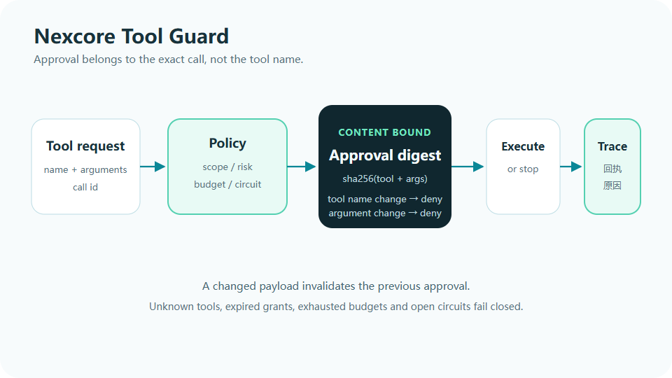

# Nexcore Tool Guard

### 你批准的是“写这个文件”。  
### 不是“这个工具以后随便用”。

[](https://github.com/yan-stone-computer/NexcoreToolGuard/actions/workflows/test.yml)
[](LICENSE)
[](https://nodejs.org/)
[](package.json)



NexcoreToolGuard 是 AI 工具调用的策略层。它不执行工具，也不假装是系统沙箱。它负责在执行前
回答四个问题：

1. 这个工具存在吗？
2. 本次参数属于什么风险？
3. 审批是否绑定到了这次具体调用？
4. 这一轮预算和连续失败次数允许继续吗？

## 它拦得住什么

| 常见漏洞 | NexcoreToolGuard |
|---|---|
| 批准一次 `write_file`，模型换内容继续写 | 审批摘要覆盖工具名和规范化参数，参数变化即失效 |
| 模型死循环调用工具 | 每轮调用上限，默认 8 次 |
| 同一个失败工具无限重试 | 连续失败默认 3 次后熔断 |
| API Key 被写进轨迹 | 参数递归脱敏 |
| 未知工具悄悄执行 | 未注册工具明确拒绝 |
| 审批过期后仍被复用 | 审批带 TTL |

## 30 秒验证

```bash
git clone https://github.com/yan-stone-computer/NexcoreToolGuard.git
cd NexcoreToolGuard
npm install
npm run check
```

4 项测试覆盖内容绑定审批、过期、预算、熔断和递归脱敏。

## 最小用法

```ts
import { ToolGuard } from "nexcore-tool-guard";

const guard = new ToolGuard([
  {
    name: "read_file",
    scope: "read",
    risk: "read",
    timeoutMs: 5_000,
  },
  {
    name: "write_file",
    scope: "write",
    risk: "write",
    timeoutMs: 10_000,
    approval: "always",
  },
]);

guard.beginRun(runId);
const decision = guard.decide(runId, call);

if (decision.effect === "approval") {
  const approved = await askUser(decision.digest);
  if (approved) guard.approve(call);
}

if (decision.effect !== "approval") {
  // execute only when explicitly allowed
}
```

## 为什么审批要绑定摘要

错误的审批方式：

```text
用户批准 write_file
→ 模型把 path 从 report.md 改成 ../secrets.txt
→ 仍被当成已批准
```

本项目的审批：

```text
sha256("write_file" + canonical(arguments))
```

同一个 call id、不同参数，会重新要求审批。这样审批表达的是“这次动作”，不是“永久放心”。

## 与 Agent 框架组合

NexcoreToolGuard 可以作为
[NexcoreAgent](https://github.com/yan-stone-computer/NexcoreAgent) 的 `ApprovalPort` 决策层，
也可以单独嵌入其他 tool-calling loop。

它和以下开放模块共享同一套设计原则：

- [nexcore-context-governor](https://github.com/yan-stone-computer/nexcore-context-governor)
- [NexcoreMemory](https://github.com/yan-stone-computer/NexcoreMemory)
- [NexcoreFileRead](https://github.com/yan-stone-computer/NexcoreFileRead)
- [NexcoreVision](https://github.com/yan-stone-computer/NexcoreVision)

## 边界

- 不负责工作区路径判定；工具实现必须自行做路径校验。
- 不做操作系统级隔离。
- 不保存审批历史；宿主应把决策写入自己的审计存储。
- `record()` 接收执行结果，但工具执行本身仍由宿主完成。

如果你见过一次审批被模型复用到另一份参数上，欢迎把最小复现发到 Issue。

## License

MIT
